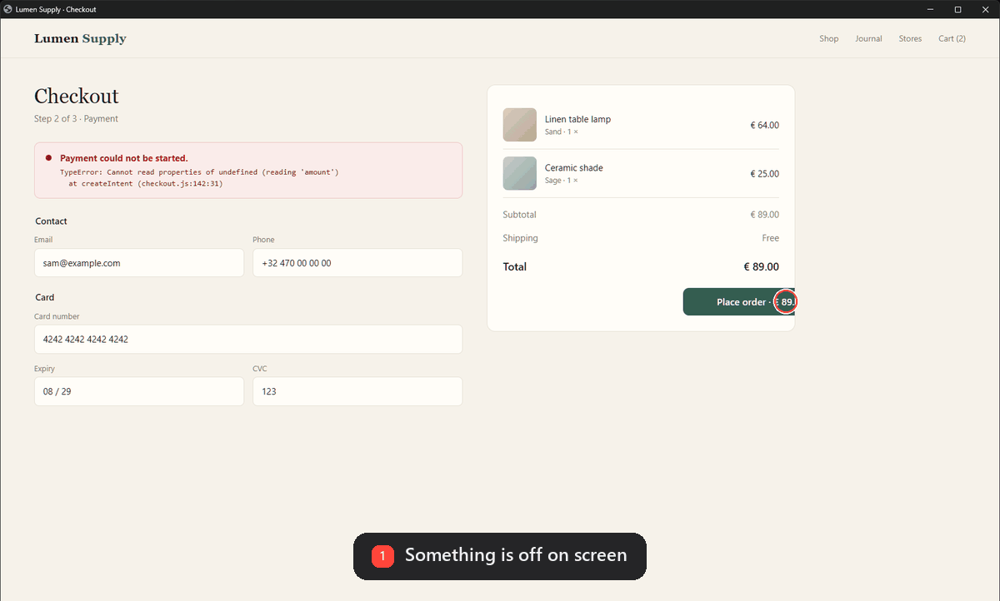
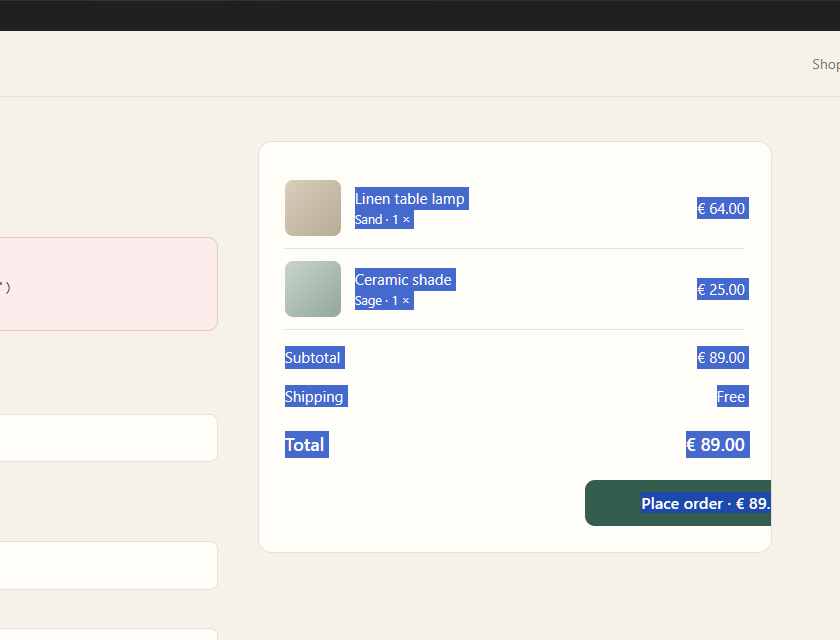
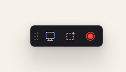

# Ekrovi

**Press PrtScr. What you see lands in your Claude chat.**
Windows · Claude desktop app · *Ekrovi* = *ekran* (Turkish for "screen") + *vi*, from Latin *videre*, "to see"



Showing Claude a bug usually takes five steps: screenshot, save, find the file, attach it, explain where you were. With Ekrovi it is one key. The image goes straight into the message box of your open Claude chat, together with what Claude needs to read it: the app, the window title, the time, where your mouse was, and the file path. You add a sentence and press Enter.

## Keys

| Key | What it sends |
|---|---|
| **PrtScr** | The screen under your mouse |
| **Alt+PrtScr** | The active window |
| **Shift+PrtScr** | An area you drag, or the window you click |
| **Ctrl+PrtScr** | A 5-second recording, as key frames (press PrtScr again to stop early) |

## What it does well

- **Recordings Claude can read.** Claude does not watch video, so Ekrovi records 5 seconds at 5 fps and sends the 4 frames where the screen actually changed. If the change happens in one small spot, the frames zoom in on it. Each frame carries its timestamp.
- **It shows where you point.** A red ring marks the mouse pointer, and the message says so, so Claude does not mistake it for part of your UI.
- **Area picker.** Drag for an area, click for a window, Esc to cancel.

  

- **A small floating button** for when you would rather click. It and the recording indicator never show up in your own screenshots or screen recordings (`WDA_EXCLUDEFROMCAPTURE`). Right-click it, or use the tray icon, for settings.

  

- **It pastes, it does not send.** You stay in control of what goes to Claude. Turn on `auto_send` if you want it to press Enter for you (only when the message box was empty).
- **It never types into the wrong window.** Before every keystroke it checks that Claude is in front. If it is not, it stops, leaves the image on the clipboard and tells you.
- **Local only.** Captures are saved in `captures/` next to the script. Nothing is uploaded except what you send to Claude yourself.

## Install

You need Windows 10 (2004 or later) or Windows 11, Python 3.10+, and the [Claude desktop app](https://claude.ai/download).

```powershell
git clone https://github.com/yilmaz-yildirim/ekrovi.git
cd ekrovi
.\install.ps1            # add -Startup to start Ekrovi with Windows
```

Or by hand:

```powershell
pip install -r requirements.txt
pythonw ekrovi.pyw
```

Starting it a second time brings the floating button back. You can also drive it from a Stream Deck, AutoHotkey or a shortcut:

```powershell
pythonw ekrovi.pyw screen    # or: window, area, record, show, quit
```

## Settings

Optional `config.json` next to the script. Every key is optional.

| Key | Default | |
|---|---|---|
| `auto_send` | `false` | Also press Enter after pasting |
| `record_seconds` | `5` | Recording length |
| `record_fps` | `5` | Frames per second while recording |
| `max_images` | `4` | Frames sent per recording |
| `mark_cursor` | `true` | Red ring around the mouse pointer |
| `language` | `"auto"` | `"en"`, `"tr"`, or follow Windows |
| `prompt_screen`, `prompt_record` | | Your own question under the image |
| `show_button` | `true` | Floating button |
| `exclude_from_capture` | `true` | Hide the button from screenshots |
| `save_dir` | `"captures"` | Where captures are kept |
| `max_edge` | `1568` | Longest side of a sent image, in pixels |

## How it works

- A low-level keyboard hook takes the PrtScr key. Windows 11 gives PrtScr to Snipping Tool before `RegisterHotKey` ever sees it, so a hook is the only way to own the key.
- `mss` grabs the screen, Pillow marks the pointer, numpy picks the frames that changed.
- The Claude window is found by process. Its message box is found through UI Automation, then the image goes on the clipboard (`CF_DIB` and `PNG`) and is pasted with Ctrl+V.

## Good to know

- It works with the **Claude desktop app** on Windows. Not with claude.ai in a browser or Claude Code in a terminal.
- It relies on how the desktop app's message box is built. An app update can break that; Ekrovi then falls back to the clipboard and tells you.
- It hooks one key (PrtScr). Some antivirus tools are wary of keyboard hooks. The script is one readable file: check it.
- PrtScr no longer opens Snipping Tool. Use **Win+Shift+S** for that.
- Windows does not pass keys on while an app running as administrator is in front. Use the button then.
- Problems end up in `ekrovi.log`.

Not affiliated with Anthropic. Claude is a trademark of Anthropic.

## License

[MIT](LICENSE)
